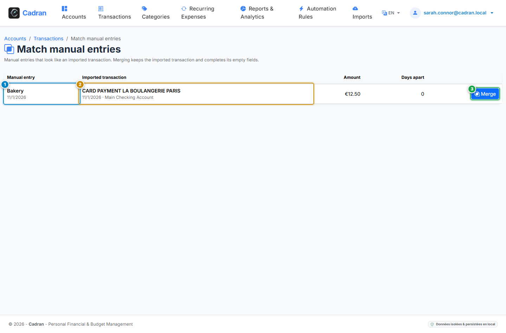

# Benutzerhandbuch: Manuelle Buchungen abgleichen

[← Zurück: 24 - Windows Tray Launcher & Backups](24-backups-supervision.md) | [Zurück zum Hauptindex](../README.md)

---

Eine **manuelle Buchung** ist eine Buchung, die Sie selbst erfasst haben, zum Beispiel eine Zahlung, bevor der Kontoauszug vorliegt. Sobald der Auszug importiert ist, ordnet die Seite **Manuelle Buchungen abgleichen** jede manuelle Buchung der entsprechenden importierten Buchung zu, sodass nur die importierte erhalten bleibt.

---

## 1. Visuelle Übersicht & Aktionsmarkierungen

---

## 2. Referenztabelle der Aktionen

| Markierung | Bedienelement | Aktionstyp | Handlungsanweisung |
| :---: | :--- | :---: | :--- |
| <kbd>1</kbd> | **Manuelle Buchung** | **PRÜFEN** | Die von Ihnen erfasste Buchung mit ihrem Datum. |
| <kbd>2</kbd> | **Importierte Buchung** | **PRÜFEN** | Die als Gegenstück vorgeschlagene importierte Buchung mit Datum und Konto. |
| <kbd>3</kbd> | **Schaltfläche „Zusammenführen"** | **HIER KLICKEN** | Führt das Paar zusammen: Die importierte Buchung bleibt erhalten, die manuelle Buchung wird gelöscht. |

---

## 3. Wie Paare vorgeschlagen werden

- Ein Paar setzt dasselbe Konto, denselben Typ (Soll oder Haben) und denselben Betrag voraus.
- Die beiden Daten müssen innerhalb der für Importe konfigurierten Duplikattoleranz liegen.
- Jede manuelle Buchung wird höchstens einer importierten Buchung zugeordnet. Die Bezeichnungen dienen nur dazu, zwischen mehreren Kandidaten zu entscheiden.

---

## 4. Was eine Zusammenführung bewirkt

- Die importierte Buchung hat immer Vorrang. Sie erhält Kategorie, Händler, Budgetdatum, benutzerdefinierten Status und Notizen der manuellen Buchung **nur dort, wo ihre eigenen Felder leer sind**.
- Die Aufteilungen der manuellen Buchung werden auf die importierte Buchung übertragen, wenn diese keine hat.
- Die manuelle Buchung wird anschließend gelöscht.

---

## 5. Schritt-für-Schritt-Anleitung

1. **Manuelle Buchung erfassen**: Über die Schaltfläche **Neue Buchung** im Buchungsjournal. Manuelle Buchungen tragen ein Badge *Manuelle Eingabe* und lassen sich mit dem Filter **Herkunft** isolieren.
2. **Kontoauszug importieren** (siehe [20 - Kontoauszug-Import](20-statement-imports.md)). Stimmen manuelle Buchungen überein, verweist ein Badge im Importergebnis auf diese Seite.
3. **Seite öffnen**: Über das Journal oder über dieses Badge, und jedes Paar vergleichen (<kbd>1</kbd>, <kbd>2</kbd>).
4. **Zusammenführen**: Führen Sie die korrekten Paare zusammen (<kbd>3</kbd>).
