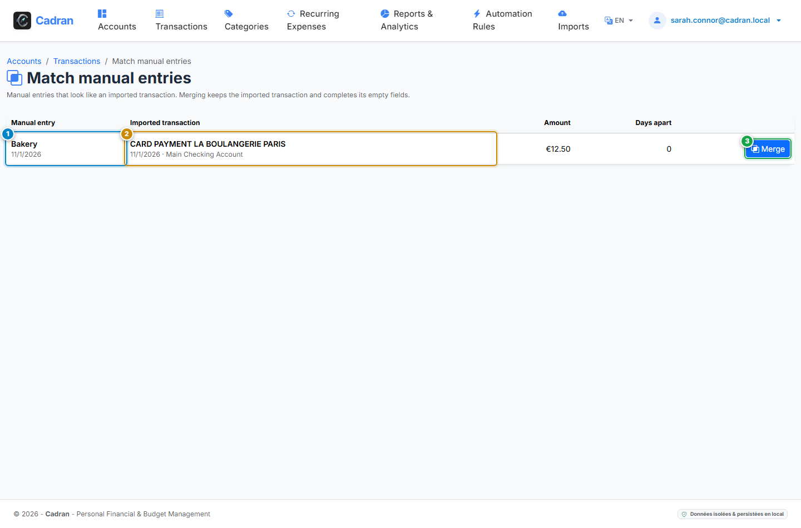

# User Guide: Matching Manual Entries

[← Previous: 24 - Windows Tray Launcher & Backups](24-backups-supervision.md) | [← Back to Master Index](../README.md)

---

A **manual entry** is an operation you typed yourself, for example a payment made before the bank statement is available. Once the statement is imported, the **Match manual entries** page pairs each manual entry with the imported transaction it corresponds to, so that only the imported one remains.

---

## 1. Visual Overview & Action Callouts

---

## 2. Action Reference Table

| Marker | UI Element | Action Type | What to do |
| :---: | :--- | :---: | :--- |
| <kbd>1</kbd> | **Manual entry** | **CHECK** | The operation you typed, with its date. |
| <kbd>2</kbd> | **Imported transaction** | **CHECK** | The imported transaction proposed as its match, with its date and account. |
| <kbd>3</kbd> | **"Merge" Button** | **CLICK HERE** | Merge the pair: the imported transaction is kept and the manual entry is deleted. |

---

## 3. How Pairs Are Proposed

- A pair requires the same account, the same type (debit or credit) and the same amount.
- The two dates must be within the duplicate tolerance configured for imports.
- Each manual entry is paired with at most one imported transaction. The labels are only used to choose between several candidates.

---

## 4. What a Merge Does

- The imported transaction always prevails. It receives the category, merchant, budget date, custom status and notes of the manual entry **only where its own fields are empty**.
- Splits of the manual entry are moved to the imported transaction when it has none.
- The manual entry is then deleted.

---

## 5. Step-by-Step Instructions

1. **Create a manual entry** from the **New operation** button of the Transactions register; manual entries carry a *Manual* badge and can be isolated with the **Origin** filter.
2. **Import your statement** (see [20 - Statement Import](20-statement-imports.md)). When manual entries match, a badge on the import result links to this page.
3. **Open the page** from the register or from that badge and compare each pair (<kbd>1</kbd>, <kbd>2</kbd>).
4. **Merge** the pairs that are correct (<kbd>3</kbd>).
